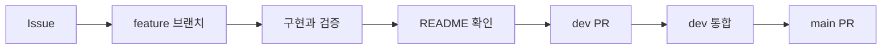

# Ipgo Server

Ipgo 서비스의 API와 서버 동작을 관리하는 저장소입니다.

> 회원가입·로그인·로그아웃과 본인 정보 조회를 제공합니다. 서버 실행에는 PostgreSQL 연결 정보가 필요합니다. 테스트는 H2 메모리 DB를 사용합니다.

## 개발 환경

| 항목 | 구성 |
|---|---|
| Java | 21 |
| Spring Boot | 4.1.2 |
| Gradle | 9.8.2, 저장소의 Wrapper 사용 |
| 기본 의존성 | Spring MVC, Validation, Actuator, OAuth2 Resource Server, JPA, Flyway, PostgreSQL 드라이버, Lombok |

기본 패키지는 `com.ipgo.server`, Gradle group은 `com.ipgo`입니다. 상품·수불부·계산·AI 연동 기능은 아직 구현하지 않았습니다.

## 프로젝트 구조

```text
src/main/java/com/ipgo/server/ProjectApplication.java  # 서버 진입점
src/main/java/com/ipgo/server/auth/                   # 회원 인증
src/main/java/com/ipgo/server/common/                 # API 오류 응답
src/main/resources/application.yaml                  # 기본 설정
src/main/resources/db/migration/                     # PostgreSQL 스키마
src/test/java/com/ipgo/server/                       # 실행·인증·migration 테스트
```

## 빌드와 실행

JDK 21을 설치하고 `JAVA_HOME`을 해당 JDK 경로로 설정합니다. Windows에서는 `./gradlew` 대신 `gradlew.bat`을 사용합니다.

```bash
# DB 연결 없이 컴파일과 실행 가능한 JAR 생성
./gradlew bootJar

# 임시 DB에서 인증·비밀번호 해시·migration 테스트
./gradlew test

# 서버 실행: PostgreSQL과 아래 환경변수 준비 후 실행
./gradlew bootRun
```

PostgreSQL을 준비한 뒤 실행 환경에 아래 변수를 설정합니다. 실제 연결 정보와 비밀값은 저장소에 기록하지 않습니다.

| 환경변수 | 용도 |
|---|---|
| `SPRING_DATASOURCE_URL` | PostgreSQL JDBC URL (`jdbc:postgresql://<host>:<port>/<database>`) |
| `SPRING_DATASOURCE_USERNAME` | DB 사용자 이름 |
| `SPRING_DATASOURCE_PASSWORD` | DB 비밀번호 |
| `SERVER_SERVLET_SESSION_COOKIE_SECURE` | HTTPS 배포에서는 `true`로 설정 |

현재 `.env` 파일을 자동으로 읽는 별도 설정은 없습니다. 터미널 또는 IDE의 실행 환경변수로 전달해야 합니다.

이메일 암호화 키는 서버 실행에 필요하지 않습니다. 이전 버전의 암호화된 회원 데이터가 있다면 아래 이관 절차를 완료할 때까지 기존 키를 보존해야 합니다.

## 인증 API

| Method | 경로 | 요청·응답 |
|---|---|---|
| GET | `/api/auth/csrf` | 로그인 전에도 호출 가능. `headerName`, `parameterName`, `token` 반환 |
| POST | `/api/auth/signup` | JSON의 `email`, `password`로 가입. 성공 시 201과 `id`, `email`, `createdAt` 반환 |
| POST | `/api/auth/login` | `application/x-www-form-urlencoded`의 `email`, `password`. 성공 시 204와 세션 쿠키 |
| GET | `/api/auth/me` | 현재 세션의 회원 정보 반환. 회원 ID를 요청으로 지정하지 않음 |
| POST | `/api/auth/logout` | 현재 세션 무효화와 쿠키 삭제. 성공 시 204 |
| GET | `/actuator/health` | 상세 정보 없는 상태 확인 |

회원가입은 자동 로그인을 수행하지 않습니다. 이메일은 소문자로 정규화하며 최대 254자, 비밀번호는 12~128자입니다. 로그인 실패는 계정 존재 여부와 관계없이 같은 401 응답을 반환합니다. 중복 이메일은 409, 입력 오류는 400, CSRF 누락·오류는 403입니다. 오류 본문은 `code`, `message`를 포함하며 비밀번호나 암호화 키를 담지 않습니다.

프론트엔드는 같은 origin 또는 개발 프록시에서 다음 순서로 호출합니다. 별도 origin의 credential CORS는 연동 주소가 확정된 뒤 설정해야 합니다.

1. `GET /api/auth/csrf`로 토큰과 세션 쿠키를 받습니다.
2. 모든 POST 요청에 응답의 `headerName`을 헤더 이름으로, `token`을 값으로 넣고 쿠키도 전송합니다.
3. 로그인 성공 후 `/api/auth/csrf`를 다시 호출합니다. 로그인 시 세션 ID와 CSRF 토큰이 갱신됩니다.
4. 로그인한 회원은 `/api/auth/me`로 확인합니다. 로그아웃 후에는 기존 인증을 사용할 수 없습니다.

세션은 HttpOnly·SameSite=Lax 쿠키를 사용하며 비활성 30분 후 만료됩니다. 서버 메모리에 보관하므로 재시작하면 로그인이 해제됩니다. 여러 서버를 동시에 운영할 때는 공유 세션 저장소를 추가해야 합니다. 배포 시 HTTPS와 로그인 요청 rate limit도 적용해야 합니다.

## 비밀번호와 개인정보 저장

- 비밀번호: PBKDF2-HMAC-SHA-256, 회원별 무작위 16바이트 salt, 600,000회 반복, 256비트 해시. `password_hash`에는 알고리즘 식별자와 salt·해시만 저장합니다. 단순 SHA-256 단회 해시는 사용하지 않습니다.
- 이메일: 앞뒤 공백을 제거하고 소문자로 정규화한 문자열을 `users.email`의 `VARCHAR(254)`에 저장합니다. 별도 암호화나 검색 해시를 사용하지 않으며 DB의 unique 제약으로 중복 가입을 방지합니다.
- DB와 백업에서 이메일을 직접 읽을 수 있으므로 접근 권한을 제한하고, 로그에 이메일과 비밀번호를 기록하지 않습니다.
- 세션의 회원 식별자는 내부 ID를 사용합니다.

기준: [OWASP 비밀번호 저장 지침](https://cheatsheetseries.owasp.org/cheatsheets/Password_Storage_Cheat_Sheet.html), [Spring Security 세션 인증](https://docs.spring.io/spring-security/reference/servlet/authentication/session-management.html).

## Database 변경과 복구

이미 병합된 `V1__create_users.sql`은 Flyway 이력을 보존하기 위해 수정하지 않습니다. 후속 `V2__store_plain_email.sql`에서 이메일을 `VARCHAR(254)`로 변경하고 unique 제약을 추가한 뒤 `email_lookup_hash`를 제거합니다. 새 DB에서는 V1과 V2를 순서대로 적용합니다. 다른 14개 테이블은 해당 기능 구현 시 추가합니다. Hibernate는 스키마를 자동 수정하지 않고 검증만 수행합니다.

V2는 첫 단계에서 기존 `v1:` 암호문을 검사합니다. 남아 있으면 칼럼 변경·삭제 전에 실패하여 서버 시작을 중단합니다. 자동 복호화나 데이터 삭제는 수행하지 않습니다.

- 적용 전: 연결 대상을 확인하고 DB 전체를 백업합니다. 회원 데이터가 없는 DB는 V2를 적용할 수 있습니다.
- 기존 암호화 데이터가 있는 경우: 서버 쓰기를 중지하고 DB·기존 AES 키·검색 키를 보존합니다. 이전 버전의 복호화 코드와 키로 이메일을 복호화·정규화하는 별도 이관을 먼저 준비하고, 누락·길이·중복을 확인한 뒤 V2를 적용해야 합니다. 이관 도구는 이번 변경에 포함하지 않습니다. 암호문 검사를 삭제하거나 Flyway repair로 우회하지 않습니다.
- 복구: V2 적용 후에는 이전 애플리케이션만 다시 실행할 수 없습니다. 서버를 중지하고 적용 전 DB 백업과 이전 애플리케이션·키를 함께 복구해야 합니다. 적용 후 신규 가입이 있었다면 복구 전 별도 보존·이관이 필요합니다.

실제 PostgreSQL에 migration을 실행하지 않았습니다. 테스트는 H2 PostgreSQL 모드에서 새 DB 적용, 암호문이 남은 경우 중단, 이관된 회원 정보 보존과 이메일 unique 제약을 확인합니다. 기존 테이블이 Flyway 관리 대상이 아니라면 자동 baseline이나 삭제로 우회하지 말고 별도 이관을 검토합니다.

## 작업 흐름



## 기본 원칙

- Issue와 PR은 쉬운 한국어로 작성합니다.
- 기술 용어는 억지로 번역하지 않습니다.
- commit은 `type: short English summary` 형식을 사용합니다.
- 모든 PR에서 README 변경 필요 여부를 확인합니다.
- `main`은 작성자 외 팀원 1명의 승인 없이 병합할 수 없습니다.

## 문서

- [개발 문서 안내](docs/README.md)
- [작업 흐름](docs/rules/workflow.md)
- [작성 규칙](docs/rules/conventions.md)
- [안전 규칙](docs/rules/safety.md)
