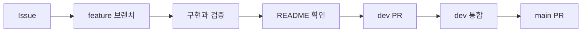

# Ipgo Server

Ipgo 서비스의 API와 서버 동작을 관리하는 저장소입니다.

> Spring Boot 기본 구성을 추가한 단계입니다. PostgreSQL 서버와 연결 설정은 아직 준비되지 않아 서버 기동과 Spring 실행 테스트는 DB 설정 오류로 실패합니다.

## 개발 환경

| 항목 | 구성 |
|---|---|
| Java | 21 |
| Spring Boot | 4.1.2 |
| Gradle | 9.8.2, 저장소의 Wrapper 사용 |
| 기본 의존성 | Spring MVC, Validation, Actuator, OAuth2 Resource Server, JPA, Flyway, PostgreSQL 드라이버, Lombok |

API, 인증 기능과 database migration은 아직 구현하지 않았습니다.

## 프로젝트 구조

```text
src/main/java/com/example/project/ProjectApplication.java  # 서버 진입점
src/main/resources/application.yaml                       # 기본 설정
src/test/java/com/example/project/ProjectApplicationTests.java  # Spring 실행 테스트
```

## 빌드와 실행

JDK 21을 설치하고 `JAVA_HOME`을 해당 JDK 경로로 설정합니다. Windows에서는 `./gradlew` 대신 `gradlew.bat`을 사용합니다.

```bash
# DB 연결 없이 컴파일과 실행 가능한 JAR 생성
./gradlew bootJar

# Spring 실행 테스트: 현재는 DB 연결 설정이 없어 실패
./gradlew test

# 서버 실행: PostgreSQL 준비와 연결 설정 후 실행
./gradlew bootRun
```

PostgreSQL을 준비한 뒤 실행 환경에 아래 변수를 설정합니다. 실제 연결 정보와 비밀값은 저장소에 기록하지 않습니다.

| 환경변수 | 용도 |
|---|---|
| `SPRING_DATASOURCE_URL` | PostgreSQL JDBC URL (`jdbc:postgresql://<host>:<port>/<database>`) |
| `SPRING_DATASOURCE_USERNAME` | DB 사용자 이름 |
| `SPRING_DATASOURCE_PASSWORD` | DB 비밀번호 |

현재 `.env` 파일을 자동으로 읽는 별도 설정은 없습니다. 터미널 또는 IDE의 실행 환경변수로 전달해야 합니다.

## 작업 흐름



## 기본 원칙

- Issue와 PR은 쉬운 한국어로 작성합니다.
- 기술 용어는 억지로 번역하지 않습니다.
- commit은 `type: short English summary` 형식을 사용합니다.
- 모든 PR에서 README 변경 필요 여부를 확인합니다.
- `main`은 작성자 외 팀원 1명의 승인 없이 병합할 수 없습니다.

## 문서

- [개발 문서 안내](docs/README.md)
- [작업 흐름](docs/rules/workflow.md)
- [작성 규칙](docs/rules/conventions.md)
- [안전 규칙](docs/rules/safety.md)
