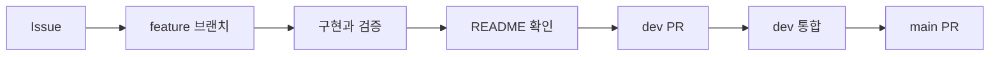

# Ipgo Server

Ipgo 서비스의 API와 서버 동작을 관리하는 저장소입니다.

> 회원가입·로그인·로그아웃과 본인 정보 조회를 제공합니다. 서버 실행에는 PostgreSQL 연결 정보와 개인정보 암호화 키가 필요합니다. 테스트는 H2 메모리 DB와 실행 중 생성한 임시 키를 사용합니다.

## 개발 환경

| 항목 | 구성 |
|---|---|
| Java | 21 |
| Spring Boot | 4.1.2 |
| Gradle | 9.8.2, 저장소의 Wrapper 사용 |
| 기본 의존성 | Spring MVC, Validation, Actuator, OAuth2 Resource Server, JPA, Flyway, PostgreSQL 드라이버, Lombok |

기본 패키지는 `com.ipgo.server`, Gradle group은 `com.ipgo`입니다. 상품·수불부·계산·AI 연동 기능은 아직 구현하지 않았습니다.

## 프로젝트 구조

```text
src/main/java/com/ipgo/server/ProjectApplication.java  # 서버 진입점
src/main/java/com/ipgo/server/auth/                   # 인증·개인정보 암호화
src/main/java/com/ipgo/server/common/                 # API 오류 응답
src/main/resources/application.yaml                  # 기본 설정
src/main/resources/db/migration/                     # PostgreSQL 스키마
src/test/java/com/ipgo/server/                       # 실행·인증·암호화 테스트
```

## 빌드와 실행

JDK 21을 설치하고 `JAVA_HOME`을 해당 JDK 경로로 설정합니다. Windows에서는 `./gradlew` 대신 `gradlew.bat`을 사용합니다.

```bash
# DB 연결 없이 컴파일과 실행 가능한 JAR 생성
./gradlew bootJar

# 임시 DB에서 인증·암호화·migration 테스트
./gradlew test

# 서버 실행: PostgreSQL과 아래 환경변수 준비 후 실행
./gradlew bootRun
```

PostgreSQL을 준비한 뒤 실행 환경에 아래 변수를 설정합니다. 실제 연결 정보와 비밀값은 저장소에 기록하지 않습니다.

| 환경변수 | 용도 |
|---|---|
| `SPRING_DATASOURCE_URL` | PostgreSQL JDBC URL (`jdbc:postgresql://<host>:<port>/<database>`) |
| `SPRING_DATASOURCE_USERNAME` | DB 사용자 이름 |
| `SPRING_DATASOURCE_PASSWORD` | DB 비밀번호 |
| `IPGO_PII_AES_KEY` | AES-256-GCM용 32바이트 난수 키의 Base64 문자열 |
| `IPGO_PII_LOOKUP_KEY` | 이메일 검색 HMAC용 별도 32바이트 난수 키의 Base64 문자열 |
| `SERVER_SERVLET_SESSION_COOKIE_SECURE` | HTTPS 배포에서는 `true`로 설정 |

현재 `.env` 파일을 자동으로 읽는 별도 설정은 없습니다. 터미널 또는 IDE의 실행 환경변수로 전달해야 합니다.

두 개인정보 키는 서로 다른 난수로 생성하고 별도로 안전하게 보관해야 합니다. 키가 없거나 형식이 잘못되면 서버가 시작되지 않습니다. 키를 잃거나 재암호화 없이 바꾸면 기존 이메일 복호화 또는 로그인이 불가능합니다. 현재 자동 키 교체 기능은 없습니다.

## 인증 API

| Method | 경로 | 요청·응답 |
|---|---|---|
| GET | `/api/auth/csrf` | 로그인 전에도 호출 가능. `headerName`, `parameterName`, `token` 반환 |
| POST | `/api/auth/signup` | JSON의 `email`, `password`로 가입. 성공 시 201과 `id`, `email`, `createdAt` 반환 |
| POST | `/api/auth/login` | `application/x-www-form-urlencoded`의 `email`, `password`. 성공 시 204와 세션 쿠키 |
| GET | `/api/auth/me` | 현재 세션의 회원 정보 반환. 회원 ID를 요청으로 지정하지 않음 |
| POST | `/api/auth/logout` | 현재 세션 무효화와 쿠키 삭제. 성공 시 204 |
| GET | `/actuator/health` | 상세 정보 없는 상태 확인 |

회원가입은 자동 로그인을 수행하지 않습니다. 이메일은 소문자로 정규화하며 최대 254자, 비밀번호는 12~128자입니다. 로그인 실패는 계정 존재 여부와 관계없이 같은 401 응답을 반환합니다. 중복 이메일은 409, 입력 오류는 400, CSRF 누락·오류는 403입니다. 오류 본문은 `code`, `message`를 포함하며 비밀번호나 암호화 키를 담지 않습니다.

프론트엔드는 같은 origin 또는 개발 프록시에서 다음 순서로 호출합니다. 별도 origin의 credential CORS는 연동 주소가 확정된 뒤 설정해야 합니다.

1. `GET /api/auth/csrf`로 토큰과 세션 쿠키를 받습니다.
2. 모든 POST 요청에 응답의 `headerName`을 헤더 이름으로, `token`을 값으로 넣고 쿠키도 전송합니다.
3. 로그인 성공 후 `/api/auth/csrf`를 다시 호출합니다. 로그인 시 세션 ID와 CSRF 토큰이 갱신됩니다.
4. 로그인한 회원은 `/api/auth/me`로 확인합니다. 로그아웃 후에는 기존 인증을 사용할 수 없습니다.

세션은 HttpOnly·SameSite=Lax 쿠키를 사용하며 비활성 30분 후 만료됩니다. 서버 메모리에 보관하므로 재시작하면 로그인이 해제됩니다. 여러 서버를 동시에 운영할 때는 공유 세션 저장소를 추가해야 합니다. 배포 시 HTTPS와 로그인 요청 rate limit도 적용해야 합니다.

## 비밀번호와 개인정보 저장

- 비밀번호: PBKDF2-HMAC-SHA-256, 회원별 무작위 16바이트 salt, 600,000회 반복, 256비트 해시. `password_hash`에는 알고리즘 식별자와 salt·해시만 저장합니다. 단순 SHA-256 단회 해시는 사용하지 않습니다.
- 이메일: AES-256-GCM으로 암호화해 `users.email`에 저장합니다. 암호화마다 12바이트 nonce를 새로 생성하고 128비트 인증 태그로 변조를 검출합니다.
- 검색·중복 검사: 별도 키의 HMAC-SHA-256을 `email_lookup_hash`에 저장하고 unique 제약을 적용합니다. 검색 해시는 GCM의 추가 인증 데이터에도 연결하여 다른 계정의 암호문으로 바꿔치기하면 복호화에 실패합니다.
- 본인 정보 응답에서만 이메일을 복호화합니다. 세션의 회원 식별자는 이메일 대신 내부 ID를 사용합니다.

기준: [OWASP 비밀번호 저장 지침](https://cheatsheetseries.owasp.org/cheatsheets/Password_Storage_Cheat_Sheet.html), [Spring Security 세션 인증](https://docs.spring.io/spring-security/reference/servlet/authentication/session-management.html).

## Database 변경과 복구

Flyway의 `V1__create_users.sql`은 빈 database에 `users` 테이블을 생성합니다. ERD의 논리적 이메일 필드는 암호화 때문에 `TEXT`로 저장하며, 중복 검사에 필요한 `email_lookup_hash`를 추가했습니다. 다른 14개 테이블은 해당 기능 구현 시 추가합니다. Hibernate는 스키마를 자동 수정하지 않고 검증만 수행합니다.

이번 구현에서는 실제 PostgreSQL에 migration을 실행하지 않았습니다. 처음 적용하기 전에 연결 대상과 백업을 확인하고, 기존 `users` 테이블이 있으면 자동 baseline이나 삭제로 우회하지 말고 별도 이관을 검토해야 합니다. 문제가 생기면 서버를 중지하고 이전 애플리케이션으로 복구하되, 생성된 테이블과 키는 보존합니다. 실제 회원 데이터가 있으면 테이블을 삭제하지 않습니다.

## 작업 흐름



## 기본 원칙

- Issue와 PR은 쉬운 한국어로 작성합니다.
- 기술 용어는 억지로 번역하지 않습니다.
- commit은 `type: short English summary` 형식을 사용합니다.
- 모든 PR에서 README 변경 필요 여부를 확인합니다.
- `main`은 작성자 외 팀원 1명의 승인 없이 병합할 수 없습니다.

## 문서

- [개발 문서 안내](docs/README.md)
- [작업 흐름](docs/rules/workflow.md)
- [작성 규칙](docs/rules/conventions.md)
- [안전 규칙](docs/rules/safety.md)
