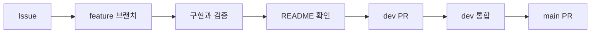

# Ipgo Server

Ipgo 서비스의 API와 서버 동작을 관리하는 저장소입니다.

> 현재는 공통 개발 규칙을 구성한 단계이며 서버 실행 환경은 이후 Issue에서 추가합니다.

## 작업 흐름

## 기본 원칙

- Issue와 PR은 쉬운 한국어로 작성합니다.
- 기술 용어는 억지로 번역하지 않습니다.
- commit은 `type: short English summary` 형식을 사용합니다.
- 모든 PR에서 README 변경 필요 여부를 확인합니다.
- `main`은 작성자 외 팀원 1명의 승인 없이 병합할 수 없습니다.

## 문서

- [개발 문서 안내](docs/README.md)
- [작업 흐름](docs/rules/workflow.md)
- [작성 규칙](docs/rules/conventions.md)
- [안전 규칙](docs/rules/safety.md)
