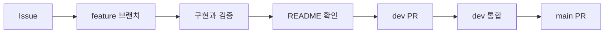

# Ipgo Server

Ipgo 서비스의 API와 서버 동작을 관리하는 저장소입니다.

> 이메일 인증을 거친 회원가입·로그인·로그아웃·본인 정보 조회와 수불부 엑셀의 로컬 원본 보관을 제공합니다. 회원 인증에는 PostgreSQL과 JWT 서명 키, 인증 메일 발송에는 SMTP 설정이 필요합니다. 업로드 파일과 보관 정보는 로컬 디스크에 저장하며, 테스트는 H2 메모리 DB·로컬 테스트 SMTP·임시 폴더를 사용합니다.

## 개발 환경

| 항목 | 구성 |
|---|---|
| Java | 21 |
| Spring Boot | 4.1.2 |
| Gradle | 9.8.2, 저장소의 Wrapper 사용 |
| 기본 의존성 | Spring MVC, Validation, Actuator, OAuth2 Resource Server, JPA, Flyway, PostgreSQL 드라이버, JavaMail, Lombok |

기본 패키지는 `com.ipgo.server`, Gradle group은 `com.ipgo`입니다. 상품 자동 등록·조회·수정과 재고관리단위 구분, 정제 결과의 서버 내부 저장·검증과 U2 조회를 제공합니다. 실제 수불부 정제 요청·AI 결과 수신과 계산 연동은 아직 구현하지 않았습니다.

## 프로젝트 구조

```text
src/main/java/com/ipgo/server/
├── ProjectApplication.java  # 서버 진입점·컴포넌트 탐색 기준
├── controller/             # HTTP 요청·응답
├── service/                # 업무 처리·트랜잭션
├── repository/             # JPA·DB 조회
├── entity/                 # JPA Entity·업로드 기간 값 객체
├── dto/                    # 내부 데이터 전달
│   ├── request/            # API 요청·입력 검증
│   └── response/           # API 응답·공통 오류 본문
├── config/                 # Spring Security 등 설정
├── security/               # JWT 발급·검증
├── exception/              # 기능별 예외·공통 예외 처리
├── infrastructure/
│   ├── mail/               # 인증 메일 발송
│   └── storage/            # 로컬 파일 보관·XLSX 검증
└── util/                   # 공통 이메일 정규화

src/main/resources/application.yaml  # 기본 설정
src/main/resources/db/migration/     # PostgreSQL 스키마
database/bootstrap/                  # 초기 PostgreSQL 역할 구성(비밀번호 미포함)
scripts/verify-postgres-migrations.sh # 실제 PostgreSQL schema·권한 검증
src/test/java/com/ipgo/server/
├── integration/            # 인증·권한·상품·업로드·migration 통합 테스트
├── config/                 # 비밀번호 인코더·쿠키 설정 테스트
├── entity/                 # 업로드 기간 값 객체 테스트
├── infrastructure/         # 메일·파일 보관 테스트
└── support/                # 공통 테스트 데이터·메일 설정
```

최상위 패키지는 기능이 아닌 역할을 기준으로 나눕니다. 회원·상품·업로드 Controller는 모두 `controller`에, Service는 `service`에 둡니다. 요청은 Controller → Service → Repository 순서로 처리하며, 외부 메일·파일 접근은 `infrastructure`에서 담당합니다. API DTO는 Controller 내부에 선언하지 않고 `dto/request`·`dto/response`에 둡니다. 패키지 재배치로 API 경로·JSON 형식·인증 정책·database 스키마는 변경하지 않습니다.

## 빌드와 실행

JDK 21을 설치하고 `JAVA_HOME`을 해당 JDK 경로로 설정합니다. Windows에서는 `./gradlew` 대신 `gradlew.bat`을 사용합니다.

```bash
# DB 연결 없이 컴파일과 실행 가능한 JAR 생성
./gradlew bootJar

# 임시 DB에서 인증·비밀번호 해시·migration 테스트
./gradlew test

# 임시 PostgreSQL 16에서 전체 migration·role·view 검증(Docker 필요)
./scripts/verify-postgres-migrations.sh

# 서버 실행: PostgreSQL과 아래 환경변수 준비 후 실행
./gradlew bootRun

# AWS one-off DB 작업 이미지 검증(Docker 필요, 임시 DB와 이미지는 자동 정리)
./scripts/verify-database-task-image.sh
```

PostgreSQL을 준비한 뒤 실행 환경에 아래 변수를 설정합니다. 실제 연결 정보와 비밀값은 저장소에 기록하지 않습니다.

| 환경변수 | 용도 |
|---|---|
| `SPRING_DATASOURCE_URL` | PostgreSQL JDBC URL (`jdbc:postgresql://<host>:<port>/<database>`) |
| `SPRING_DATASOURCE_USERNAME` | DB 사용자 이름 |
| `SPRING_DATASOURCE_PASSWORD` | DB 비밀번호 |
| `SPRING_FLYWAY_ENABLED` | runtime과 migration 자격 증명을 분리할 때 runtime은 `false` |
| `IPGO_JWT_SECRET` | 32바이트 이상의 무작위 키를 Base64로 인코딩한 JWT 서명 키. 모든 서버에서 동일한 키 사용 |
| `IPGO_AUTH_COOKIE_SECURE` | 기본 `true`. 로컬 HTTP 개발에서만 `false`, 배포에서는 HTTPS와 `true` 사용 |
| `IPGO_UPLOAD_DIR` | 원본·보관 정보 저장 폴더. 기본값은 실행 디렉터리의 `./storage/uploads` |

현재 `.env` 파일을 자동으로 읽는 별도 설정은 없습니다. 터미널 또는 IDE의 실행 환경변수로 전달해야 합니다.

### AWS DB one-off 작업 이미지

`Dockerfile.database`는 애플리케이션 이미지와 분리된 DB 관리 전용 이미지입니다. `bootstrap`은
최초 PostgreSQL 역할 생성과 비밀번호 설정, `migrate`는 Flyway V1~V13 적용과 이력 확인,
`verify`는 Spring DML·AI 조회 권한과 금지 권한을 점검합니다. AWS에서는 각 명령을 별도 ECS
one-off task로 실행하며 상시 서비스에서는 이 이미지를 사용하지 않습니다.

비밀번호는 Secrets Manager에서 환경변수로만 주입하고 Docker image, Git, task command와 로그에
기록하지 않습니다. RDS bootstrap administrator는 `bootstrap` task에만 전달합니다. `migrate`와
`verify` task에는 각각 필요한 최소 역할만 전달합니다. 실제 RDS 실행은 migration 직전 snapshot이
`available`인 것을 확인하고 Server·AI service가 0인 상태에서만 진행합니다.

### AWS dev 실행

AWS에서는 `IPGO_UPLOAD_STORAGE=s3`와 `IPGO_UPLOAD_BUCKET`을 설정해 원본을 private S3에
저장합니다. ECS task role의 임시 자격 증명을 사용하므로 애플리케이션에 AWS Access Key를 넣지
않습니다. DB 연결 값과 JWT 서명 키는 Secrets Manager에서 주입하고 runtime에서는 Flyway를
실행하지 않습니다.

`dev` 브랜치의 `Deploy server to AWS dev` workflow는 수동 승인 후 GitHub OIDC로 image를 ECR에
push하고 ECS task revision을 갱신합니다. GitHub `dev` Environment 승인과
`AWS_DEPLOY_ROLE_ARN`, `AWS_ACCOUNT_ID` 변수가 필요하며 실제 Secret 값은 GitHub에 저장하지
않습니다. 배포가 끝난 뒤 `desired_count`를 `0`으로 내려 task 실행 비용을 멈출 수 있습니다.

JWT 키는 환경변수 또는 비밀 관리 도구에서 주입하며 Git·로그에 기록하지 않습니다. 키가 없거나 형식·길이가 잘못되면 서버 시작을 중단합니다. 키를 변경하면 기존 액세스 토큰은 검증에 실패합니다. 테스트에서는 임시 키를 자동 생성하므로 PostgreSQL·서명 키 설정 없이 `./gradlew test`를 실행할 수 있습니다. H2는 테스트에서만 사용합니다.

### 실제 PostgreSQL로 테스트

`./gradlew test`는 기본으로 H2를 씁니다. H2와 PostgreSQL은 타입 검사가 달라서, 표·조회를 바꿨다면 실제 PostgreSQL로도 한 번 돌려 봅니다. 테스트가 행을 만들고 회원을 지우므로 **비어 있는 검증용 DB만** 씁니다. 아래 비밀번호는 이 검증용 컨테이너에서만 쓰는 임시 값으로 바꿔 넣습니다.

```bash
# 1) 검증용 PostgreSQL 띄우기 (끝나면 docker rm -f ipgo-pg-check)
docker run -d --name ipgo-pg-check -e POSTGRES_DB=ipgo -e POSTGRES_USER=ipgo \
  -e POSTGRES_PASSWORD=<임시 비밀번호> -p 127.0.0.1:55432:5432 postgres:17

# 2) 같은 테스트를 PostgreSQL에서 실행
IPGO_TEST_DB_URL=jdbc:postgresql://127.0.0.1:55432/ipgo \
IPGO_TEST_DB_USERNAME=ipgo IPGO_TEST_DB_PASSWORD=<임시 비밀번호> ./gradlew test
```

`IPGO_TEST_DB_URL`을 주지 않으면 H2로 돌아갑니다. 회원을 모두 지우는 인증 테스트는 H2나 `IPGO_TEST_DB_URL`로 직접 지정한 DB에서만 실행되고, 그 밖의 DB면 실패해서 멈춥니다.

이메일 암호화 키는 서버 실행에 필요하지 않습니다. 이전 버전의 암호화된 회원 데이터가 있다면 아래 이관 절차를 완료할 때까지 기존 키를 보존해야 합니다.

## 인증 API

| Method | 경로 | 요청·응답 |
|---|---|---|
| GET | `/api/auth/csrf` | `headerName`, `parameterName`, `token`과 HttpOnly CSRF 쿠키 반환. 로그인 전에도 호출 가능 |
| GET | `/api/auth/email-availability?email=...` | 200 `{"available":true}`. 이미 가입한 이메일은 `false` |
| POST | `/api/auth/email-verifications` | JSON `{"email":"seller@example.test"}` → 202 `{"expiresIn":600}` |
| POST | `/api/auth/email-verifications/confirm` | JSON의 `email`, `code` → 200 `{"verificationToken":"..."}` |
| POST | `/api/auth/signup` | 아래 JSON으로 가입. 성공 시 201과 `userId`, `email`, `managerName`, `companyName` 반환 |
| POST | `/api/auth/login` | 기존 form-urlencoded의 `email`, `password`. 성공 시 **200**과 액세스 JWT JSON·리프레시 쿠키 |
| POST | `/api/auth/refresh` | 리프레시 쿠키·CSRF 헤더로 갱신. 성공 시 200과 새 액세스 JWT JSON·새 리프레시 쿠키 |
| GET | `/api/auth/me` | 200과 `userId`, `email`, `managerName`, `companyName`. 회원 ID를 요청으로 지정하지 않음 |
| POST | `/api/auth/logout` | 리프레시 쿠키·CSRF 헤더로 현재 로그인 폐기·쿠키 삭제. 204. 이미 로그아웃한 경우도 204 |
| GET | `/actuator/health` | 상세 정보 없는 상태 확인 |

가입 요청 예시입니다. `verificationToken`에는 A7에서 받은 실제 토큰을 전달합니다.

```json
{
  "email": "seller@example.test",
  "password": "Test123!",
  "companyName": "테스트 회사",
  "managerName": "담당자",
  "businessRegNo": "0123456789",
  "verificationToken": "<A7에서 받은 토큰>"
}
```

- `companyName`, `managerName`: 앞뒤 공백을 제거한 뒤 1~50자, 필수.
- `businessRegNo`: 선택. 생략·null·빈 문자열은 미입력으로 처리하며, 입력하면 숫자 10자리여야 합니다. 실제 사업자 등록 여부는 조회하지 않습니다.
- 응답 ID 이름은 명세대로 `userId`입니다. 이전 `id`, `createdAt` 응답은 제거했습니다.
- 신규 가입 비밀번호는 **8~16자**이며, 영문 대문자(`A-Z`)·소문자(`a-z`)·숫자(`0-9`)·특수기호를 각각 1개 이상 포함해야 합니다. 허용 문자는 공백을 제외한 ASCII 문자(`U+0021`~`U+007E`)이며, 특수기호는 이 범위에서 영문·숫자를 제외한 모든 기호입니다. 공백·줄바꿈·탭·한글·이모지는 허용하지 않으며 비밀번호의 앞뒤 공백을 자동 제거하지 않습니다.
- 정책 위반 시 `400 INVALID_INPUT`, `details.field=password`와 비밀번호 규칙을 설명하는 `message`를 반환합니다. 프론트도 동일한 길이·문자·복잡도 검증을 적용해야 합니다. 비밀번호 정책 변경은 신규 가입에만 적용하며 기존 회원의 비밀번호 해시는 유지합니다.
- 로그인 요청은 기존 form-urlencoded를 유지하지만 성공 응답은 204에서 **200 + JWT**로 변경합니다. JSON 로그인은 지원하지 않습니다. 화면 표시 정보는 Bearer 토큰으로 `/api/auth/me`에서 받습니다.

회원가입은 자동 로그인을 수행하지 않습니다. 이메일은 소문자로 정규화하며 최대 254자입니다. 로그인 실패는 계정 존재 여부와 관계없이 같은 401 응답을 반환합니다. 중복 이메일은 409, 입력 오류는 400, CSRF 누락·오류는 403입니다. 오류 본문은 `code`, `message`를 포함하며 민감한 입력값을 담지 않습니다. 입력 필드 검증 실패는 `details.field`에 필드 이름 하나를 추가합니다. JSON 자체가 깨진 경우에는 필드를 특정하지 않습니다.

### JWT·리프레시·로그아웃 계약 (#28)

로그인·갱신 성공 JSON은 다음과 같습니다. 리프레시 토큰 원문은 JSON에 포함하지 않습니다.

```json
{"accessToken":"<서명된 JWT>","tokenType":"Bearer","expiresIn":900}
```

- 액세스 토큰: HS256 JWT, 기본 15분. `iss=ipgo-server`, `aud=ipgo-api`, `sub=회원 ID`, `sid=로그인 ID`, `jti`, `iat`, `exp`를 포함합니다. 이메일·비밀번호는 담지 않습니다.
- 리프레시 토큰: 32바이트 무작위 값을 Base64url로 인코딩하며 DB에는 SHA-256 해시만 저장합니다. 쿠키 이름은 `ipgo_refresh`, `HttpOnly`, `SameSite=Lax`, `Path=/api/auth`, 배포 시 `Secure`입니다. `Domain`은 지정하지 않습니다.
- 로그인 유지 기간은 최초 로그인부터 **7일로 고정**합니다. 갱신마다 토큰을 교체하고 이전 토큰은 일회 사용 처리하지만 7일 마감은 연장하지 않습니다. 새 JWT도 로그인 만료 시각을 넘지 않으므로 마지막 15분에는 `expiresIn`이 900보다 작을 수 있습니다. 쿠키 `Max-Age`도 남은 기간으로 설정합니다.
- 이미 사용된 리프레시 토큰을 다시 사용하면 해당 로그인 전체를 폐기합니다. 같은 회원의 다른 로그인은 유지합니다. 동일 로그인에 대한 갱신·로그아웃은 DB 행 잠금으로 순서를 보장합니다.
- 모든 보호 API는 `Authorization: Bearer <accessToken>`으로 인증합니다. 기존 `JSESSIONID`나 리프레시 쿠키만으로는 인증되지 않습니다. JWT 서명·발급자·대상·만료·회원 ID를 검사하고 요청마다 DB의 로그인 상태도 확인합니다. DB 장애 시 인증을 우회하지 않습니다.
- 로그아웃은 현재 리프레시 쿠키의 로그인을 폐기합니다. 해당 로그인에서 발급한 **기존 JWT도 로그아웃 commit 후 새 요청부터 즉시 401**이 됩니다. 이미 인증을 통과해 실행 중인 요청을 취소하는 기능은 아닙니다. 쿠키가 없는 로그아웃은 멱등적으로 204를 반환하므로 프론트는 반드시 `credentials: 'include'`로 호출합니다.
- 서버의 메모리 HTTP 세션은 사용하지 않습니다. 재시작 시 DB와 서명 키가 유지되면 로그인도 유지됩니다. 만료·폐기된 로그인과 사용 토큰 해시의 자동 정리 작업은 아직 없습니다. 사용된 해시는 최소 해당 로그인 만료까지 보관해야 재사용을 감지할 수 있습니다.

프론트는 같은 origin 또는 개발 프록시에서 다음 순서로 호출합니다. 별도 origin의 credential CORS는 연동 주소가 확정된 뒤 설정해야 합니다. 다른 site 배포에서 `SameSite=None`이 필요하다면 HTTPS·CORS·CSRF 설정을 함께 검토합니다.

1. `GET /api/auth/csrf`를 `credentials: 'include'`로 호출합니다. HttpOnly `IPGO-XSRF-TOKEN` 쿠키는 브라우저가 보관하고, JSON의 `headerName`·`token`을 인증 관련 POST 헤더에 사용합니다.
2. 이메일 확인 → 인증 메일 발송 → 코드 확인 → 가입 순서로 진행합니다. 로그인도 기존 form-urlencoded 요청에 CSRF 헤더와 쿠키를 포함합니다.
3. 로그인 성공 시 액세스 JWT는 프론트 메모리에 보관하고, 일반 API에는 Bearer 헤더로 전달합니다. **상품·입고 조건·기존 발주·업로드 등 Bearer API는 CSRF 헤더가 필요 없습니다.**
4. 로그인 성공 시 CSRF 쿠키가 초기화되므로 `/api/auth/csrf`를 다시 호출해 갱신·로그아웃에 사용할 토큰을 받습니다. 새로고침으로 액세스 토큰을 잃은 경우에도 CSRF를 받은 뒤 `/api/auth/refresh`로 복구할 수 있습니다.
5. 일반 API가 `401 ACCESS_TOKEN_EXPIRED`를 반환하면 `/api/auth/refresh`를 `credentials: 'include'`·CSRF 헤더와 함께 한 번 호출합니다. 성공 시 새 JWT로 원래 요청을 한 번 재시도합니다. 모든 401에 무조건 갱신하거나 무한 재시도하지 않습니다.
6. 갱신 요청은 프론트에서 하나만 실행하고 대기 중인 요청들이 결과를 공유해야 합니다. 여러 탭에서도 갱신을 조율해야 합니다. 엄격한 일회 사용 정책이므로 중복 갱신 또는 갱신 성공 응답 유실 후 이전 토큰 재시도는 로그인을 폐기할 수 있습니다. 이 경우 다시 로그인합니다.
7. 로그아웃은 `/api/auth/logout`에 쿠키와 CSRF 헤더를 전송하고, 성공하면 프론트의 액세스 토큰을 지웁니다. 갱신·로그아웃은 만료된 Bearer 헤더가 있어도 쿠키로 처리하지만 **CSRF는 항상 필요**합니다. 로그아웃 후에는 CSRF 쿠키도 초기화됩니다.

`/login`, `/refresh`, `/logout` 서버 API는 구현돼 있지만 프론트의 자동 갱신·요청 재시도 코드는 별도 프론트 작업입니다. API·프록시 로그에서 Authorization, Cookie, Set-Cookie와 토큰 응답 본문을 기록하지 않습니다. 공개 운영 전 로그인·갱신 요청 rate limit을 적용해야 합니다.

| HTTP | code | 프론트 처리 |
|---|---|---|
| 401 | `ACCESS_TOKEN_EXPIRED` | 한 번 갱신 후 원래 요청 재시도 |
| 401 | `INVALID_ACCESS_TOKEN` | 변조·잘못된 JWT. 토큰 제거 후 재로그인 |
| 401 | `SESSION_REVOKED` | 로그아웃·폐기된 로그인. 토큰 제거 후 재로그인 |
| 401 | `INVALID_REFRESH_TOKEN` | 누락·알 수 없는·폐기된 리프레시 토큰. 재로그인 |
| 401 | `REFRESH_TOKEN_EXPIRED` | 최초 로그인부터 7일 만료. 재로그인 |
| 401 | `REFRESH_TOKEN_REUSED` | 이전 리프레시 토큰 재사용으로 로그인 폐기. 재로그인 |
| 403 | `FORBIDDEN` | 인증 관련 POST의 CSRF 누락·오류 또는 리소스 소유권 위반 |

## 이메일 인증과 SMTP 설정

인증 코드는 6자리이며 발송 요청 시점부터 10분간 유효합니다. 같은 이메일은 60초에 한 번 재발송할 수 있고, 새 발송에 성공하면 이전 코드와 가입 토큰은 무효가 됩니다. 코드를 5회 틀리면 해당 코드가 무효가 되며 재발송이 필요합니다. 형식 자체가 잘못된 요청은 입력 오류로 처리합니다.

코드 확인 성공 시 30분간 유효한 무작위 가입 토큰을 반환합니다. 같은 이메일의 가입에만 한 번 사용할 수 있습니다. 가입 저장에 실패하면 토큰 사용도 취소되어 재시도할 수 있습니다. 코드와 토큰은 원문 대신 해시를 DB에 저장하고 API·로그로 코드를 노출하지 않습니다. 이메일은 가입 API와 동일하게 소문자로 정규화합니다.

SMTP 서비스와 발신 주소를 준비한 후 아래 환경변수를 실행 환경에 주입합니다. 비밀번호나 API 키를 채팅·문서·Git에 적지 않습니다.

| 환경변수 | 용도 |
|---|---|
| `SPRING_MAIL_HOST` | SMTP 서버 주소. 이 설정이 있어야 메일 발송기가 생성됨 |
| `SPRING_MAIL_PORT` | 제공업체의 SMTP 포트 |
| `SPRING_MAIL_USERNAME` | SMTP 인증 계정 |
| `SPRING_MAIL_PASSWORD` | SMTP 비밀번호 또는 업체가 발급한 SMTP 자격 증명 |
| `IPGO_MAIL_FROM` | 업체에서 허용한 발신 이메일 주소 |
| `SPRING_MAIL_PROPERTIES_MAIL_SMTP_AUTH` | 인증 사용 시 `true` |
| `SPRING_MAIL_PROPERTIES_MAIL_SMTP_STARTTLS_ENABLE` | STARTTLS 사용 시 `true` |
| `SPRING_MAIL_PROPERTIES_MAIL_SMTP_STARTTLS_REQUIRED` | STARTTLS 필수인 서비스는 `true` |
| `SPRING_MAIL_PROPERTIES_MAIL_SMTP_SSL_ENABLE` | implicit TLS 서비스에서 사용. 포트와 TLS 방식은 업체 안내에 맞춤 |

SMTP 연결·읽기·쓰기 제한은 각각 5초입니다. SMTP 설정이 없더라도 서버는 시작할 수 있지만, 인증 메일 요청은 503을 반환하며 인증이 필요한 신규 가입은 완료할 수 없습니다. 발송에 실패하면 코드·토큰·재발송 제한 상태를 이전 상태로 되돌립니다. 202는 SMTP가 메일을 수락했다는 뜻이며 실제 수신함 도착을 보장하지 않습니다. 스팸 분류와 반송은 메일 서비스에서 확인해야 합니다.

| HTTP | code | 의미 |
|---|---|---|
| 400 | `INVALID_INPUT` | 입력 오류. 가능한 경우 `details.field` 포함 |
| 400 | `INVALID_EMAIL_CODE` | 잘못된 코드, 5회 실패 또는 이미 사용한 코드 |
| 400 | `EMAIL_CODE_EXPIRED` | 10분이 지난 코드 |
| 400 | `INVALID_VERIFICATION_TOKEN` | 잘못된·만료된·사용된 토큰 또는 다른 이메일 |
| 401 | `INVALID_CREDENTIALS` | 로그인 정보 불일치 |
| 401 | `UNAUTHENTICATED` | 로그인 필요 |
| 409 | `DUPLICATE_EMAIL` | 이미 가입한 이메일 |
| 429 | `EMAIL_VERIFICATION_RATE_LIMITED` | 60초 내 재발송 요청 |
| 503 | `EMAIL_DELIVERY_UNAVAILABLE` | SMTP 미설정 또는 발송 실패 |

```json
{"code":"INVALID_INPUT","message":"입력값의 형식과 길이를 확인해주세요.","details":{"field":"companyName"}}
```

동일 이메일의 동시 발송·코드 확인·가입은 DB 행 잠금으로 처리합니다. SMTP 발송도 해당 트랜잭션에서 수행하므로 같은 이메일의 요청은 발송 완료까지 대기합니다. SMTP 수락 직후 DB commit이 실패하면 메일의 코드가 유효하지 않을 수 있으므로 재발송이 필요합니다. 별도 발송 큐는 추가하지 않았습니다.

공개 운영 전에는 이메일별 제한 외에 IP·전체 발송량 제한과 메일 서비스 한도를 설정해야 합니다. 만료 상태는 요청 시 검사하며, 만료된 행은 현재 자동 삭제하지 않습니다. `email_verifications`의 보관 기간과 정리 작업도 운영 전에 정해야 합니다. 이메일 중복 조회는 요청한 명세에 따라 가입 여부를 알려줍니다.

## 수불부 엑셀 원본 업로드

현재 단계의 API는 `POST /api/uploads`입니다. Bearer 인증 헤더를 포함하여 `multipart/form-data`의 `file` 필드에 파일 하나를 보냅니다. 사용자 ID는 검증된 JWT에서 결정하며 요청의 사용자 ID로 저장 위치를 선택할 수 없습니다. 창고 선택은 아직 받지 않습니다. 기존 업로드 API 명세가 제공되지 않아 아래 형식을 이번 단계의 계약으로 정의했습니다.

```javascript
// accessToken은 로그인 또는 갱신 응답에서 받은 JWT입니다.
const body = new FormData();
body.append('file', fileInput.files[0]);
const response = await fetch('/api/uploads', {
  method: 'POST',
  credentials: 'include',
  headers: { Authorization: `Bearer ${accessToken}` },
  body,
});
const result = await response.json();
if (!response.ok) throw new Error(result.message ?? '업로드에 실패했습니다.');
// FormData의 Content-Type은 브라우저가 boundary와 함께 설정하도록 둡니다.
```

한 요청에 파일 1개(`file`)만 보냅니다. 여러 파일은 화면에서 하나씩 따로 보냅니다. 성공 시 `202 Accepted`와 다음 형식의 JSON을 반환합니다. `PROCESSING`은 원본 보관과 업로드 기록이 끝났고 정제·검증은 아직이라는 뜻입니다. `uploadId`는 업로드 기록(`upload_files`)의 숫자 ID이며 U2 결과 조회에 씁니다.

```json
{
  "uploadId": 12,
  "status": "PROCESSING",
  "originalName": "2026-09.xlsx",
  "periodStart": "2026-09-01",
  "periodEnd": "2026-09-30"
}
```

| 제한·오류 | 동작 |
|---|---|
| 파일 형식 | `.xlsx`만 허용. `.xls`, `.xlsm`, CSV, 암호로 잠긴 파일은 지원하지 않음 |
| 크기 | 파일 10MiB, multipart 전체 요청 11MiB. 초과 시 `413 FILE_TOO_LARGE` |
| 파일명 | 경로 구분자·제어 문자·콜론 포함, 빈 이름, 255자 초과는 `400 INVALID_INPUT` |
| 빈 파일·누락·손상 | `400 INVALID_INPUT`. `.xlsx`가 아닌 확장자는 `400 UPLOAD_INVALID_FORMAT`(`details`에 `fileName`·`reason`) |
| 저장 실패 | `500 UPLOAD_STORAGE_ERROR`. 내부 경로와 파일 내용은 응답하지 않음 |
| 인증 | 유효한 Bearer JWT 필요. 미인증·만료·폐기된 로그인은 401. CSRF 불필요 |
| 자료 기간 | 파일명의 연·월로 정함 (`2026-09.xlsx`, `수불부_202609.xlsx`, `2026년 9월.xlsx` → 9/1~9/30). 못 읽거나 연·월이 여러 개면 `400 UPLOAD_INVALID_FORMAT`, `details`에 `fileName`·`reason` |
| 같은 기간 | 이미 올린 기간이면 `409 UPLOAD_DUPLICATE`, `details.reason`은 `SAME_PERIOD`, `details.existing`에 기존 업로드(ID·이름·기간·업로드 일시). `overwrite=true`로 다시 보내면 새 revision으로 저장 |
| 같은 파일 | 내용(SHA-256)이 완전히 같은 파일을 **다른 기간** 이름으로 올리면 `overwrite`와 상관없이 `409 UPLOAD_DUPLICATE`, `details.reason`은 `SAME_FILE`. 화면은 덮어쓰기 대신 "이미 올린 파일"로 안내합니다. 같은 기간이면 `SAME_PERIOD`로 처리하므로 같은 파일을 덮어써 다시 정제할 수 있습니다. 다른 회원의 파일과 `FAILED` 업로드는 비교하지 않습니다 |

### 업로드 기록과 이미 올린 기간

원본을 보관한 뒤 `upload_files`에 파일 1개당 1행(창고·원본 이름·보관 키·해시·기간·revision·상태)을 저장합니다. 같은 기간을 덮어쓰면 `revision_no`를 1 올린 새 행을 만들고 이전 행은 이력으로 남깁니다. 기간 확인부터 기록까지 회원의 창고 행을 잠가서 같은 기간 동시 업로드를 하나씩 처리합니다. 창고 선택은 아직 없으며, 첫 업로드 때 회원의 기본 창고를 자동으로 만듭니다. 새 기록의 상태는 `PROCESSING`이며 Python 정제 연동 전까지 바뀌지 않습니다. `FAILED` 기록은 같은 기간 판정에서 제외합니다.

`GET /api/uploads/periods`(U3)는 기간마다 가장 마지막 revision 1개와 가장 최근 업로드 ID를 돌려줍니다.

```json
{"items": [{"period": "2026-09", "uploadId": 12, "fileName": "2026-09.xlsx", "periodStart": "2026-09-01",
  "periodEnd": "2026-09-30", "uploadedAt": "2026-10-28T10:00:00+09:00", "status": "PROCESSING"}], "latestUploadId": 12}
```

업로드 일시(`uploadedAt`)는 한국 시간(+09:00)으로 돌려줍니다. DB에는 시간대 포함 시각으로 저장합니다.

### 업로드 결과 조회 (U2 · #26 1차)

`GET /api/uploads/{uploadId}`는 본인의 처리 상태·자료 기간·검증 보고서를 반환합니다.
Bearer 인증이 없으면 401, 다른 회원 자료면 403, 없는 업로드면 404입니다.

```json
{"uploadId":12,"status":"PROCESSING","periodStart":"2026-09-01","periodEnd":"2026-09-30",
 "asOfDate":null,"runId":null,"validation":null,"matchedReceipts":[],"error":null}
```

DONE이면 `asOfDate`와 `validation`의 `checkedSkuCount`, `targetSkuCount`, `excludedSkus`가 채워집니다.
제외 항목은 서버가 확인한 `productId`, `skuBarcode`, `skuName`, `date`, `reason`을 포함합니다.
FAILED이면 `error.code`와 안전한 `error.message`를 반환합니다. 처리 중·실패의 기준일과 검증 집계는 null입니다.

정제 결과 저장 경계는 상품·LOT·일별 수불·보고서·상태를 한 트랜잭션에서 저장하고, 잘못된 jobId나
다른 업로드의 행을 거절합니다. 같은 결과의 중복 전달과 같은 창고의 동시 처리를 잠금으로 보호합니다.
이전 revision과 셀러가 수정한 상품 값은 보존합니다. 기존 schema를 사용하며 새 migration은 없습니다.

**현재 일반 업로드에서 AI 호출·큐 발송은 자동 실행되지 않습니다.** 이 단계는 결과 저장·조회 경계이며,
실제 AI 연결은 아직 미완료입니다. `runId`는 #27 전까지 null, `matchedReceipts`는 정책 확정 전까지 빈 배열입니다.
추정 입고 주기는 보고서에만 보관합니다. 프론트 타입·문구 조정과 남은 합의는
[#26 구현 범위](docs/decisions/0002-upload-cleaning-boundary.md)를 확인합니다.

DB 기록 저장이 실패하면 이미 보관한 원본 폴더는 남을 수 있습니다.

확장자나 클라이언트의 Content-Type만 신뢰하지 않고 ZIP의 CRC, 필수 OOXML 구성과 주요 XML을 확인합니다. 압축 해제 총량 100MiB, 항목 수 2,000개, 검사 대상 주요 XML 하나당 1MiB로 제한하며 매크로·DTD·외부 엔티티를 거절합니다. 검사 중 ZIP 내용을 파일로 풀지 않습니다. 이 검사는 기본 컨테이너 검사이며 모든 셀·관계의 유효성 검사나 악성코드 검사를 대신하지 않습니다. 수불부 필수 열·기간·재고 검산은 Python 연동 단계에서 수행합니다.

### 로컬 보관 구조

```text
storage/uploads/<인증된 사용자 ID>/<보관 UUID>/
  original.xlsx   # 업로드한 바이트 그대로 보관
  metadata.json   # userId 및 보관 정보(크기·SHA-256·보관 시각)
```

같은 이름을 다시 업로드해도 새 ID를 사용하므로 기존 원본을 덮어쓰지 않습니다. 파일 해시는 같은 파일 판정에만 쓰고 중복 파일을 자동 병합하지 않습니다. 원본과 메타데이터를 임시 디렉터리에 모두 쓴 뒤 같은 파일시스템 내 atomic move로 완료 위치에 옮깁니다. 일반적인 실패는 임시 파일을 정리하며, 강제 종료 때 남은 `.pending-*`는 완료 파일로 취급하지 않습니다. 강제 종료 후에는 서버를 중지한 상태에서 해당 디렉터리를 확인하고 정리해야 합니다.

저장 폴더는 애플리케이션 계정만 쓰도록 관리하고 static 리소스·공개 웹 디렉터리 밖에 둡니다. 사용자 하위 디렉터리가 심볼릭 링크이면 저장을 거절합니다. `.gitignore`에 기본 `storage/`를 제외했으며, 사용자 지정 경로도 Git에 포함하지 않아야 합니다. 재시작으로 원본은 삭제되지 않습니다. 컨테이너 사용 시 영속 볼륨과 백업이 필요합니다.

이번 단계는 단일 서버 로컬 보관만 지원합니다. 누적 용량 제한·자동 정리·재시도 중복 방지·다운로드·삭제는 구현하지 않았습니다. 외부 공개 전에 요청 제한과 디스크 용량 관리를 마련해야 합니다. 롤백 시 파일을 지우지 말고 저장 폴더 전체를 보존합니다. 업로드 기록 표는 `V5__create_upload_files.sql`에서 만듭니다.

검증은 임시 폴더의 원본·메타데이터 보존, 동일 이름 업로드, 잘못된 파일·압축 폭탄·경로 입력, 저장 실패 정리, JWT 사용자 연결, 실제 HTTP 로그인·갱신·로그아웃·업로드·용량 제한을 포함합니다. 프론트 화면과 실제 PostgreSQL 통합 검증은 별도입니다.

구현 참고: [Spring multipart 업로드](https://spring.io/guides/gs/uploading-files/), [OWASP 파일 업로드 지침](https://cheatsheetseries.owasp.org/cheatsheets/File_Upload_Cheat_Sheet.html).

## 상품과 재고관리단위(LOT)

정제 결과의 한 줄(바코드·상품명·`sku_mixed_id`·입고일)을 받아 `ProductRegistrationService`가 상품과 재고관리단위를 자동 등록합니다(BE-05). Python 정제 연동 전이라 아직 업로드 흐름에서 호출하지 않습니다. 창고 선택은 아직 없으며 `WarehouseService`가 회원당 기본 창고 1개를 만들어 씁니다.

- 상품: 회원별 바코드 1개 = 1행. 처음 나온 바코드만 새로 만들고, 이미 있는 상품의 이름은 셀러가 고쳤을 수 있으므로 덮어쓰지 않습니다. 업로드에 안 나왔다는 이유로 비활성화하지 않습니다.
- 재고관리단위: 같은 창고의 `sku_mixed_id` + 입고일이 처음일 때만 새로 만듭니다. 같은 `sku_mixed_id`라도 입고일이 다르면 다른 단위입니다. 유통기한은 Should 기능이라 저장하지 않습니다.

| API | 동작 |
|---|---|
| `GET /api/products?query=&page=0&size=20` (P1) | 내 상품 목록. `query`는 상품명(대소문자 무시)·바코드 일부로 검색. `size`는 1~100. 응답 `{items, total, page, size}`, 항목은 `productId`, `skuBarcode`, `skuName`, `unitCost`(원 단위 정수), `isActive`, `settings`(실제 적용되는 입고 조건), `overridden`(기본값 대신 상품별 값을 쓰는 칸 이름) |
| `PATCH /api/products/{productId}` (P2) | `skuName`(1~200자)·`unitCost`(0 이상)·`isActive` 중 보낸 칸만 수정. Bearer JWT 필요. 다른 회원 상품 `403 FORBIDDEN`, 없는 상품 `404 NOT_FOUND` |

### 입고 조건 (S1~S3)

리드타임·입고 주기·입고 단위를 창고 기본값(`warehouses.default_*`)과 상품별 값(`replenishment_settings`)으로 저장합니다(BE-06). 상품별 값이 비어 있으면 기본값을 씁니다. 모든 값은 1 이상 정수이며, 0 이하·소수·누락은 `400 INVALID_INPUT`과 `details.field`로 응답합니다. 정수 칸에 소수를 보내면 잘라내지 않고 거절합니다.

| API | 동작 |
|---|---|
| `GET /api/replenishment-settings` (S1) | 기본값 조회. 셀러가 저장하기 전에는 `confirmed: false`와 제안값(리드타임 5일, 입고 단위 1개, `reviewCycleSource: "ESTIMATED"`)을 돌려줍니다. 저장 뒤에는 `confirmed: true`, `"DEFAULT"` |
| `PUT /api/replenishment-settings` (S2) | `{leadTimeDays, reviewCycleDays, orderUnitQty, recalculate}`. 세 칸 모두 필수. 응답 `{"saved": true, "runId": null}` |
| `PUT /api/products/{productId}/replenishment-settings` (S3) | `{leadTimeDays, reviewCycleDays, orderUnitQty, unitCost}`. 입고 조건 세 칸은 보낸 값으로 모두 바꾸며, 비우면 기본값을 따릅니다. `unitCost`(0 이상)는 보낸 경우에만 바꿉니다. 다른 회원 상품 `403`, 없는 상품 `404` |

S2·S3 모두 Bearer JWT가 필요하며 CSRF는 요구하지 않습니다. 수불부로 입고 주기를 추정하는 기능은 정제 연동 전이라 아직 없어서, 제안 단계의 `reviewCycleDays`는 `null`입니다. 저장 뒤 계산을 시작하는 기능(`runId`, `recalculate`)은 계산 엔진 연동 때 붙이며, 그 전까지 `runId`는 `null`입니다.

### 기존 발주 물량 (R1~R3)

이미 발주했지만 아직 도착하지 않은 물량(상품·수량·도착 예정일)을 `planned_receipts`에 저장합니다(BE-07). 도착 예정일이 있으면 `PENDING`(계산에 반영), 없으면 `NO_DATE`(저장만 하고 계산 제외)입니다. 수량은 1 이상 정수입니다.

| API | 동작 |
|---|---|
| `GET /api/planned-receipts` (R1) | 취소하지 않은 발주 목록. 도착 예정일 빠른 순, 예정일 없는 발주는 맨 뒤. 응답 `{items, total}`, 항목은 `receiptId`, `productId`, `skuName`, `quantity`, `expectedOn`, `receivedOn`, `status`, `reflected` |
| `POST /api/planned-receipts` (R2) | `{productId, quantity, expectedOn}`. `201 {"receiptId", "reflected", "runId": null}`. `reflected: false`면 화면이 "계산에 반영되지 않음"을 안내 |
| `PATCH /api/planned-receipts/{receiptId}` (R3) | `quantity`·`expectedOn` 중 보낸 칸만 수정. `NO_DATE`에 도착일을 넣으면 `PENDING` |
| `DELETE /api/planned-receipts/{receiptId}` (R3) | 취소. `204`. 행은 지우지 않고 `CANCELLED`로 남기며, 이후 수정·취소는 `404` |

R2·R3은 Bearer JWT가 필요하고, 다른 회원의 상품·발주는 `403`, 없는 상품·발주는 `404`입니다. 수불부 입고로 도착을 확인하는 `RECEIVED`와 기준일이 지났는데 입고가 없는 `OVERDUE` 판정은 정제 연동 뒤에 붙입니다. 저장 뒤 계산 시작(`runId`)도 계산 엔진 연동 때 붙입니다.

## 대시보드와 SKU 상세 (D1 · K1)

`calculation_runs`·`calculation_results`(V9)에 저장된 가장 최근 성공 계산을 읽어 보여줍니다(BE-11 · BE-12). 계산 엔진 연동(#27) 전에는 이 표를 채우는 코드가 없어 결과가 비어 있으며, 테스트는 표에 결과를 직접 넣어 확인합니다.

| API | 동작 |
|---|---|
| `GET /api/dashboard/replenishment-needs?sort=shortage` (D1) | 입고 필요 목록. `sort`는 `shortage`(소진일 빠른 순, 기본) · `risk`(품절 위험 높은 순) · `amount`(금액 큰 순), 그 밖의 값은 `400`. 계산 결과가 없으면 `asOfDate`·`runId`가 `null`이고 목록이 비어 있습니다. 셀러가 사용을 끈(`isActive: false`) 상품은 계산 뒤에 껐더라도 모든 목록과 개수에서 빠지고, 다시 켜면 남아 있는 결과로 바로 다시 보입니다 |
| `GET /api/products/{productId}/detail?from=&to=` (K1) | SKU 상세: 상품 · 입고 조건과 출처(`PRODUCT`·`DEFAULT`·`SUGGESTED`/`ESTIMATED`) · 계산 근거 · 정확도 · 재고 추이(`trend`). `trend`는 정제가 끝난 업로드의 상품 일별 수불(날짜 · 기말 재고 · 출고 · 유효 관측일)이고, 같은 날짜를 덮어써 올렸으면 가장 최근 업로드 값을 씁니다. `from`·`to`가 없으면 마지막 수불 날짜까지 90일입니다. 다른 회원 상품 `403`, 없는 상품 `404`, `from`이 `to`보다 늦거나 날짜 형식이 틀리면 `400` |

- 판정: 화면을 열 때마다 오늘(한국 시간) 기준으로 다시 맞춥니다. 예상 소진일이 오늘 + 리드타임 안이면 `NEED_NOW`, 아니면 `NOT_NEEDED`입니다. 리드타임은 지금 적용되는 입고 조건(상품별 값 → 기본값 → 제안값)을 씁니다.
- 기준일이 7일 넘게 지나면 `REUPLOAD_REQUIRED`이며, D1에서는 계산 불가 목록에 재업로드 안내 사유와 함께 보여줍니다.
- 가장 최근 계산이 실패했으면 이전 성공 결과를 보여주면서 `resultStatus: STALE`과 `lastFailedRunAt`을 함께 돌려줍니다.
- 화면용 정수(미확정): 재고는 내림, 수요(예상 출고 · 미충족 수요 · 예측 범위)는 올림, 금액은 원 단위 반올림입니다. 팀 결정이 나면 `DisplayQuantities`만 바꿉니다.
- D1 `excluded[].date`는 그 계산에 쓴 업로드(`run_source_files`)의 검증 리포트에서 찾은 검산 불일치 날짜입니다. 리포트에 없으면 `null`입니다.
- 아직 비어 있는 값: K1 `accuracy.history`(백테스트 연동 이후), `result.requiredQtyBeforeRounding`(ERD 저장 칸 없음).

## 비밀번호와 개인정보 저장

- 비밀번호: PBKDF2-HMAC-SHA-256, 회원별 무작위 16바이트 salt, 600,000회 반복, 256비트 해시. `password_hash`에는 알고리즘 식별자와 salt·해시만 저장합니다. 단순 SHA-256 단회 해시는 사용하지 않습니다.
- 이메일: 앞뒤 공백을 제거하고 소문자로 정규화한 문자열을 `users.email`의 `VARCHAR(254)`에 저장합니다. 별도 암호화나 검색 해시를 사용하지 않으며 DB의 unique 제약으로 중복 가입을 방지합니다.
- DB와 백업에서 이메일을 직접 읽을 수 있으므로 접근 권한을 제한하고, 로그에 이메일과 비밀번호를 기록하지 않습니다.
- JWT의 회원 식별자는 내부 ID를 사용합니다. 리프레시 토큰은 해시만 DB에 저장합니다.

### 사용자별 접근 제한 (BE-02)

- 로그인 없이 쓸 수 있는 API는 CSRF 토큰 받기, 이메일 중복 확인, 인증 메일 발송 · 확인, 가입, 로그인입니다. 갱신·로그아웃은 Bearer 대신 리프레시 쿠키와 CSRF로 처리합니다. 보호 API에 Bearer 토큰이 없으면 `401 UNAUTHENTICATED`입니다.
- 회원 ID는 요청 값이 아니라 검증된 JWT에서만 가져옵니다. 목록 API(상품 · 기존 발주 · 이미 올린 기간 · 입고 조건 기본값)는 자기 데이터만 돌려줍니다.
- ID로 대상을 고르는 API(상품 수정 · 상품별 입고 조건 · 기존 발주 등록 · 수정 · 취소)는 주인이 아니면 `403 FORBIDDEN`, 없으면 `404 NOT_FOUND`입니다.
- `AccessControlTests`가 등록된 모든 `/api/**` API를 돌며 로그인 없이 열리는 API가 없는지 확인합니다. 공개 API를 새로 만들 때는 `SecurityConfig`와 이 테스트의 공개 목록을 함께 바꿔야 합니다.

기준: [OWASP 비밀번호 저장 지침](https://cheatsheetseries.owasp.org/cheatsheets/Password_Storage_Cheat_Sheet.html), [Spring Security JWT](https://docs.spring.io/spring-security/reference/servlet/oauth2/resource-server/jwt.html)·[CSRF](https://docs.spring.io/spring-security/reference/servlet/exploits/csrf.html).

## Database 변경과 복구

이미 병합된 migration은 Flyway 이력을 보존하기 위해 수정하지 않습니다. 새 DB에서는 V1~V13을 순서대로 적용합니다. V4는 `warehouses`·`products`·`inventory_units`, V5는 `upload_files`, V6은 `replenishment_settings`, V7은 `planned_receipts`, V8은 `auth_sessions`·`refresh_tokens`, V9는 `calculation_runs`·`calculation_results`, V10은 일별 수불 2개 표, V11은 계산 출처·시나리오·백테스트·AI 인사이트 4개 표를 추가합니다. V12는 PostgreSQL tenant 무결성 trigger, V13은 FastAPI view와 역할별 권한을 적용합니다. 전체 관계와 변경 규칙은 [Database ERD v1](docs/database/erd-v1.md)에 있습니다. Hibernate는 스키마를 자동 수정하지 않고 검증만 수행합니다.

초기 PostgreSQL은 administrator가 `database/bootstrap/create_roles.sql`을 먼저 실행한 뒤 `ipgo_migrator`로 Flyway를 적용합니다. bootstrap SQL은 `ipgo_migrator`·`ipgo_server`·`ipgo_ai_reader` 역할만 만들고 비밀번호는 설정하지 않습니다. 비밀번호는 repository·shell history·Terraform state에 남기지 않고 승인된 Secrets Manager 절차로 설정합니다. Spring runtime은 `ipgo_server`, FastAPI는 `ipgo_ai_reader`를 사용하며 runtime에서는 `SPRING_FLYWAY_ENABLED=false`로 migration 자격 증명을 분리합니다.

V2는 첫 단계에서 기존 `v1:` 암호문을 검사합니다. 남아 있으면 칼럼 변경·삭제 전에 실패하여 서버 시작을 중단합니다. 자동 복호화나 데이터 삭제는 수행하지 않습니다.

- 적용 전: 연결 대상을 확인하고 DB 전체를 백업합니다. 회원 데이터가 없는 DB는 V2를 적용할 수 있습니다.
- 기존 암호화 데이터가 있는 경우: 서버 쓰기를 중지하고 DB·기존 AES 키·검색 키를 보존합니다. 이전 버전의 복호화 코드와 키로 이메일을 복호화·정규화하는 별도 이관을 먼저 준비하고, 누락·길이·중복을 확인한 뒤 V2를 적용해야 합니다. 이관 도구는 이번 변경에 포함하지 않습니다. 암호문 검사를 삭제하거나 Flyway repair로 우회하지 않습니다.
- 복구: V2 적용 후에는 이전 애플리케이션만 다시 실행할 수 없습니다. 서버를 중지하고 적용 전 DB 백업과 이전 애플리케이션·키를 함께 복구해야 합니다. 적용 후 신규 가입이 있었다면 복구 전 별도 보존·이관이 필요합니다.

V3는 `users`에 `company_name`, `manager_name`, `business_reg_no`와 별도 `email_verifications` 테이블을 추가합니다. 기존 회원의 이메일·ID·비밀번호를 변경하지 않습니다. 기존 회원에게 없던 회사·담당자 정보를 임의 생성하지 않기 위해 DB 칼럼은 nullable이며, 신규 가입의 필수 조건은 API에서 검사합니다. 기존 회원의 `/me`에는 회사·담당자 값이 null일 수 있어 프론트에서 기본 표시를 준비하고 추후 데이터를 보완해야 합니다.

V3 적용 전 DB 백업을 보관합니다. 이전 V2 애플리케이션으로 일시 복귀해도 추가 칼럼 자체는 유지할 수 있지만, 이전 버전의 가입은 이메일 인증을 요구하지 않으므로 복귀 시 신규 가입을 중단해야 합니다. V3 적용 후 발생한 데이터를 지우거나 Flyway 이력을 임의 변경하지 않습니다. 스키마까지 되돌려야 하면 서버 쓰기를 중지하고 신규 데이터를 보존한 뒤 적용 전 백업으로 복구합니다.

V8은 로그인 상태와 리프레시 토큰 해시 이력을 추가하며 기존 회원·비밀번호는 바꾸지 않습니다. 사용자 삭제 시 해당 로그인·토큰 행은 FK cascade로 함께 삭제됩니다. 적용 전에 DB 백업과 JWT 키를 준비하고 프론트의 200 응답·Bearer·갱신 처리를 함께 배포해야 합니다. 기존 세션 쿠키는 더 이상 인증되지 않아 재로그인이 필요합니다.

V8 애플리케이션 롤백 시 서버 쓰기를 중지하고 이전 서버·프론트의 세션 방식으로 함께 복귀합니다. 추가 테이블은 보존하고 다시 JWT 버전으로 전환하기 전에 기존 로그인 행을 폐기하는 절차를 준비합니다. 그렇지 않으면 롤백 전 토큰이 다시 유효해질 수 있습니다. 스키마까지 복구해야 하면 적용 전 백업을 사용하며, 이후 생성된 데이터는 별도 보존해야 합니다. Flyway 이력을 임의 삭제·수정하지 않습니다.

H2 PostgreSQL 모드 테스트는 공통 SQL인 V1~V11과 애플리케이션 동작을 확인합니다. `scripts/verify-postgres-migrations.sh`는 임시 PostgreSQL 16에 V1~V9와 기존 행을 준비한 뒤 V10~V13으로 upgrade하고, 18개 업무 테이블, tenant 무결성, Spring DML, FastAPI view SELECT와 원본 table DML·DDL 거부를 확인합니다. 기존 테이블이 Flyway 관리 대상이 아니라면 자동 baseline이나 삭제로 우회하지 말고 별도 이관을 검토합니다.

V10~V13은 기존 업무 행을 삭제하지 않습니다. 다만 V12는 이미 서로 다른 회원 데이터가 연결돼 있거나 발주 상태와 날짜가 맞지 않으면 적용을 중단하고, V13은 세 역할이 준비되지 않으면 적용을 중단합니다. 적용 전에는 RDS snapshot을 만들고 connection 대상과 row count를 확인합니다. 애플리케이션만 롤백할 때는 새 표와 view를 보존합니다. 스키마까지 되돌려야 하면 쓰기를 중지하고 적용 전 snapshot을 복구하며, 적용 후 들어온 데이터는 먼저 별도 보존합니다.

## 작업 흐름



## 기본 원칙

- Issue와 PR은 쉬운 한국어로 작성합니다.
- 기술 용어는 억지로 번역하지 않습니다.
- commit은 `type: short English summary` 형식을 사용합니다.
- 모든 PR에서 README 변경 필요 여부를 확인합니다.
- `main`은 작성자 외 팀원 1명의 승인 없이 병합할 수 없습니다.

## 문서

- [개발 문서 안내](docs/README.md)
- [작업 흐름](docs/rules/workflow.md)
- [작성 규칙](docs/rules/conventions.md)
- [안전 규칙](docs/rules/safety.md)
