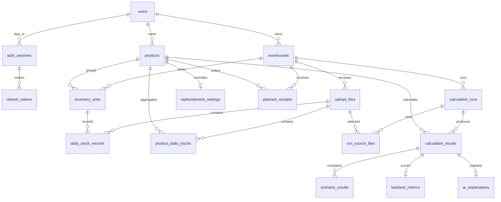

# Database ERD v1

기준일: 2026-10-29
정본: `src/main/resources/db/migration/V1`~`V13`

Google Drive의 ERD v6 16개 테이블을 기준으로 하되, 현재 인증 구현의
`auth_sessions`·`refresh_tokens`를 포함해 **업무 테이블 18개**를 관리합니다.
그림이나 과거 문서와 migration이 다르면 적용 가능한 SQL인 Flyway migration을 우선합니다.

## 관계



`email_verifications`는 가입 전에 생기므로 `users`와 FK로 연결하지 않습니다.
`ai_product_daily_stocks_v1`은 테이블이 아니라 FastAPI용 read-only view입니다.

## 테이블과 migration

| 묶음 | 테이블 | migration | 핵심 조건 |
|---|---|---|---|
| 계정 | `users`, `email_verifications` | V1~V3 | 이메일 unique, 인증 시도 0~5 |
| 인증 | `auth_sessions`, `refresh_tokens` | V8 | 회원 삭제 시 로그인 이력 cascade |
| 기준 정보 | `warehouses`, `products`, `inventory_units` | V4 | 회원별 창고 코드·바코드 unique |
| 업로드 | `upload_files` | V5 | 창고·기간 시작·revision unique |
| 셀러 입력 | `replenishment_settings`, `planned_receipts` | V6~V7 | 양수 조건, 발주 상태·날짜 일치 |
| 일별 수불 | `daily_stock_records`, `product_daily_stocks` | V10 | source별 날짜 unique, 수량 `NUMERIC(18,3)` |
| 계산 | `calculation_runs`, `calculation_results` | V9 | run별 상품 결과 1개 |
| 계산 이력 | `run_source_files`, `scenario_results` | V11 | source 복합 PK, result별 scenario type unique |
| 평가·설명 | `backtest_metrics`, `ai_explanations` | V11 | result별 각각 최대 1행 |

V12의 PostgreSQL trigger는 다음 교차 연결을 거부합니다.

- 서로 다른 회원의 상품과 창고를 `inventory_units`·`planned_receipts`에 연결
- 생성된 창고·상품의 회원 소유자 변경
- 업로드 파일과 다른 창고의 재고관리단위를 `daily_stock_records`에 연결
- 상품 소유자와 업로드 창고 소유자가 다른 `product_daily_stocks`
- 계산 창고와 다른 창고의 파일을 `run_source_files`에 연결
- 계산 창고 소유자와 다른 회원의 상품을 `calculation_results`에 연결

## AI 조회 계약

`ai_product_daily_stocks_v1`은 `DONE` 상태의 업로드만 노출하고 아래 칼럼을 제공합니다.

| 칼럼 | 출처 |
|---|---|
| `product_id` | `product_daily_stocks` |
| `warehouse_id` | `upload_files` |
| `upload_file_id`, `stock_date` | `product_daily_stocks` |
| `opening_qty`, `inbound_qty`, `outbound_qty`, `adjustment_qty`, `closing_qty` | `product_daily_stocks` |
| `is_valid_observation` | `product_daily_stocks` |

FastAPI는 요청의 `warehouse_id`와 `upload_file_ids`로 source를 다시 제한합니다.
view 이름이나 칼럼을 바꿀 때는 새 버전 view를 먼저 추가하고 AI 배포가 끝난 뒤 이전 버전을
제거합니다.

## Database 역할

| 역할 | 허용 | 금지 |
|---|---|---|
| `ipgo_migrator` | Flyway DDL, 객체 소유 | 애플리케이션 런타임 사용 |
| `ipgo_server` | 18개 업무 테이블 DML, sequence 사용 | schema/table 생성·변경, Flyway 이력 변경 |
| `ipgo_ai_reader` | `ai_product_daily_stocks_v1` SELECT | 원본 테이블 SELECT, 모든 DML·DDL |

초기 빈 DB에서 administrator가 `database/bootstrap/create_roles.sql`을 먼저 실행합니다. 이 SQL은
비밀번호를 만들거나 출력하지 않습니다. 각 login role의 비밀번호는 Secrets Manager를 이용한
승인된 절차로 별도 설정합니다. 그다음 `ipgo_migrator`로 Flyway를 실행하고, Spring과 FastAPI에는
각자의 runtime role만 전달합니다.

## 변경 규칙

1. 이미 적용한 migration은 수정하지 않고 `V14`, `V15`처럼 새 파일을 추가합니다.
2. nullable 칼럼이나 새 테이블을 먼저 추가하는 expand 단계부터 배포합니다.
3. 기존 데이터를 작은 단위로 backfill하고 건수·NULL·중복을 확인합니다.
4. 새 코드를 배포한 뒤 이전 칼럼·view를 제거하는 contract migration을 별도 배포합니다.
5. 삭제·타입 축소·대량 갱신 전에는 RDS snapshot과 복구 시간을 확인합니다.
6. 실패한 migration을 `repair`로 숨기지 않습니다. 원인을 고치거나 snapshot을 복구한 뒤
   forward migration으로 정리합니다.

## 아직 유연하게 둔 값

다음 값은 서비스 간 계약이 최종 확정되지 않아 DB enum/check로 잠그지 않았습니다.

- `daily_stock_records.quality_status`
- `ai_explanations.mode`, `ai_explanations.status`, `ai_explanations.versions`
- 직접 입력 `CUSTOM` 시나리오의 새 결과 생성·덮어쓰기 정책

계약이 확정되면 기존 데이터 값을 먼저 검사한 뒤 새 migration에서 제약을 추가합니다.

## 검증

```bash
./gradlew test
./scripts/verify-postgres-migrations.sh
```

두 번째 명령은 외부 포트를 열지 않는 임시 PostgreSQL 16을 만들고 삭제합니다. 빈 DB에 V1~V9를
적용하고 기존 행을 넣은 뒤 V10~V13으로 upgrade합니다. 이후 18개 테이블, tenant 무결성,
Spring DML, FastAPI view SELECT, DML·DDL 거부를 확인합니다.
