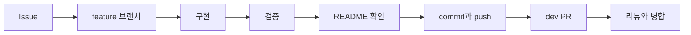

# 작업 흐름

## 브랜치

| 브랜치 | 역할 | 변경 방식 |
|---|---|---|
| `main` | 안정적으로 사용할 수 있는 코드 | `dev → main` PR만 허용 |
| `dev` | 완료된 기능의 통합과 검증 | feature PR로 변경 |
| `feature/*` | Issue별 작업 | 최신 `dev`에서 생성 |

## 작업 기준

1. Issue의 목적·작업·완료 조건을 확인합니다.
2. `feature/<issue-number>-<description>` 브랜치를 만듭니다.
3. 구현 후 관련 검사를 실행합니다.
4. README에서 기능·구조·실행 방법·환경 변수 변경을 반영합니다.
5. 영어 commit을 만들고 branch를 push합니다.
6. 한국어 PR에 변경·위험·영향·검증 결과를 기록합니다.

README 변경이 없으면 PR에 이유를 한 줄로 남깁니다. 최초 빈 `main` commit은 저장소 초기화를 위한 한 번의 예외이며 이후 직접 push는 금지합니다.

## main 보호

- 작성자 외 팀원 1명 승인 필수
- 새 commit이 추가되면 기존 승인 무효화
- 미해결 리뷰 대화가 있으면 병합 금지
- 관리자 우회, force push와 branch 삭제 금지
