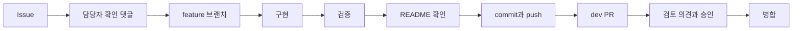

# 작업 흐름

## 브랜치

| 브랜치 | 역할 | 변경 방식 |
|---|---|---|
| `main` | 안정적으로 사용할 수 있는 코드 | `dev → main` PR만 허용 |
| `dev` | 완료된 기능의 통합과 검증 | feature PR로 변경 |
| `feature/*` | Issue별 작업 | 최신 `dev`에서 생성 |

## 업무 할당 확인

- 팀장은 Jira와 GitHub Issue로 업무를 분장합니다. Jira에서는 작업명·담당자·일정·상태를,
  GitHub Issue에서는 목적·상세 작업·완료 조건·제외 범위와 개발 논의를 확인합니다.
- 담당자는 업무를 시작하기 전에 Jira와 GitHub Issue를 모두 확인합니다.
- 다른 의견이나 개선 제안이 있으면 GitHub Issue에 근거와 함께 댓글로 남깁니다.
- 별도 의견이 없더라도 `확인했습니다. 해당 내용대로 진행하겠습니다.`와 같은 댓글로 확인과
  진행 의사를 남깁니다. 모든 업무 할당에는 담당자의 확인 기록이 필요합니다.

## 작업 기준

1. Issue의 목적·작업·완료 조건을 확인합니다.
2. `feature/<issue-number>-<description>` 브랜치를 만듭니다.
3. 아래 준비 확인과 재검사 기준을 적용하고 구현 후 관련 검사를 실행합니다.
4. README에서 기능·구조·실행 방법·환경 변수 변경을 반영합니다.
5. 영어 commit을 만들고 branch를 push합니다.
6. 한국어 PR에 변경·위험·영향·검증 결과를 기록합니다.

README 변경이 없으면 PR에 이유를 한 줄로 남깁니다. 최초 빈 `main` commit은 저장소 초기화를 위한 한 번의 예외이며 이후 직접 push는 금지합니다.

## 준비 확인과 재검사 기준

목적은 검사 전에 환경 문제를 발견하고, 같은 성공 근거를 이유 없이 다시 만들지 않는 것입니다.
기능·DB·권한 검증, 필수 CI, 승인·백업·쓰기 직전 확인과 변경 후 독립 검증은 그대로 유지합니다.

### 1. 시작할 때 한 번 확인

- 조회마다 확인할 질문과 결과에 따른 다음 행동을 먼저 정합니다. 이미 답이 있는 같은 질문의
  재조회나 조사 경로만 바꾸는 반복은 하지 않습니다. 지정 업무가 없으면 열린 이슈 목록을 한 번
  확인하고, 기존 승인 대기/완료 근거는 해당 범위만 재사용합니다. 비교용 업무를 만들지 않습니다.
- 입력 호환성은 현재 코드·계약·사용 중인 리더의 원본과 작은 재현 자료부터 확인합니다. 이것으로
  판정할 수 있으면 외부 문서 탐색을 더하지 않습니다. 외부 근거가 필요해 접근에 실패하면 같은
  조회를 다른 경로로 반복하기 전에 이미 확보한 로컬 근거로 해결 가능한지 확인합니다.
- 최신 `dev`의 SHA, 작업 브랜치와 기존 변경을 확인합니다. 다른 작업의 파일을 덮어쓰지 않습니다.
- 이번 목적·완료 조건·영향 파일과 필수 검사 목록을 한 작업 기록에 정합니다. 검사마다 실행 위치,
  명령·옵션·환경·시험자료와 합격 기준을 적습니다. API·DB 변경이 있으면 관련 계약·권한·경합 검사도 포함합니다.
- 시간 비교는 같은 작업 유형·변경/검증 범위·환경·계측 경계의 이전 실제 업무를 골라 시작합니다.
  조건이 다르면 참고치로만 남기고 감소율을 계산하지 않습니다.

| 해당 작업 | 전체 검사·외부 쓰기 전에 확인할 것 |
|---|---|
| Java/Gradle 검사 | JDK 21, wrapper 버전, 사용할 `GRADLE_USER_HOME`의 읽기·쓰기 권한과 하위 파일 소유권. 오프라인 실행에는 해당 버전의 `wrapper/dists`와 필요한 `caches/modules-2` 자료가 모두 있어야 합니다. 디렉터리 존재만으로 의존성이 준비됐다고 판정하지 않습니다. |
| 임시 PostgreSQL 검사 | Docker 접근, 검사 스크립트가 요구하는 이미지·아키텍처, bootstrap 역할·migration·seed 준비 순서를 확인합니다. 필요한 이미지를 먼저 확인하고, 폐기된 태그를 추측해 반복 실행하지 않습니다. |
| 실제 API 검사 | 전용 시험계정이 탈퇴·잠금 상태가 아닌지와 로그인·권한을 먼저 확인합니다. 읽기로 확인할 수 있는 조건을 확인하기 전에 시험 주문 등 쓰기를 시작하지 않습니다. |
| 결제 검사 | 일반결제/자동결제 중 목표 경로, TEST 모드, runtime과 시험 거래의 상점·주문·금액 일치를 확인합니다. 다른 경로의 성공으로 대체하지 않습니다. 실제 결제·환급은 별도 승인 대상입니다. |

Java 버전은 `JAVA_HOME`과 Gradle이 실제 선택하는 toolchain까지 확인합니다. 기본 `java -version`이
17이어도 Gradle이 21을 선택할 수 있으므로 기본 명령의 버전만으로 실패 판정하지 않습니다.
Gradle·Docker의 준비 확인은 필요한 해당 경로에만 수행합니다. 비밀값·인증 파일 내용은 출력하지 않습니다.
캐시가 공유되거나 권한이 다르면 원본 캐시를 재귀 `chmod/chown`하지 않고, 승인된 작업용 캐시와
준비 경로를 사용합니다. Linux/Docker에서는 `bash scripts/testing/local-gradle.sh <기존 검사 인자>`를
기본으로 사용합니다. 공유 캐시는 읽기 원본으로만 쓰며 처음 준비한 사용자 전용 캐시를 다음
worktree에서도 재사용합니다. 매번 전체 캐시를 복사하거나 준비 확인을 위해 별도 전체 검사를
실행하지 않습니다. 내부 daemon·버전별 파일까지 소유권/권한을 검사하고 맞지 않으면 실행 전에
중단합니다. `--prepare-only`는 캐시 확인이며 의존성 해결·기능 검사 통과를 의미하지 않습니다.
오프라인 의존성이 없으면 같은 명령을 반복하지 말고 기존 허용된 온라인
준비 경로나 검증된 캐시를 선택합니다. 이미지 pull 등 외부 영향·비용은 기존 승인 경계를 따릅니다.
계정·PG·운영 DB 접근 권한을 준비 과정에서 임의로 넓히지 않습니다.

### 2. 최종본을 고정하고 검사

- 검사 명령·로그 경로·결과 집계 명령은 준비/구현 중 완성합니다. `validation`으로 먼저 바꾼 뒤
  명령을 새로 작성하지 않습니다. 단계 전환과 기존 검사 실행을 같은 도구 호출로 이어갑니다.
  통합 작업 공간의 서버 검증 고정 명령을 재사용하고, 독립 checkout에서는 README의 명령을 사용합니다.
- 편집을 마친 뒤 검사 대상 SHA와 미커밋 diff/파일 지문을 남깁니다. 검사 중 같은 파일과 검사 정의를
  수정하지 않습니다. 검사가 도는 동안 고정본의 diff·계약·문서 검토를 읽기 전용으로 병행합니다.
- 빠른 영향 검사로 먼저 문제를 찾고, 최종본에서 확정한 필수 검사 목록을 끝냅니다. 로컬 전체 검사는
  안정된 최종본에서 시작하며, 중간판 전체 검사가 필요한 구체적 위험은 먼저 기록합니다.
- 기존 명령을 사용합니다: Java는 README의 Gradle 검사, DB 변경은
  `scripts/verify-postgres-migrations.sh` 등 영향 범위의 PostgreSQL/권한·migration 검사,
  배포 판정은 `scripts/deployment/verify_deployment.py`와 기존 운영 절차를 사용합니다.
  `.github/workflows/test.yml`·`database.yml`의 실행 조건과 필수 job을 이 절차로 줄이지 않습니다.
- 실행이 진행 중이면 반환된 같은 session/run handle을 최대 30초씩 기다립니다. 진행 중인 검사와
  겹치는 대기를 별도 지연으로 더하지 않습니다. 오류·실제 기한 초과·handle 유실이 없으면 경과시간
  확인용 로그 조회나 별도 컨테이너 검색을 추가하지 않습니다. 관측 만료만으로 재실행하지 않습니다.
- 같은 실행 명령의 끝에서 종료 코드와 XML 결과를 한 번 집계합니다. 완료를 받은 뒤 임의 스크립트를
  다시 작성하거나 같은 결과를 재조회하지 않습니다. 고정본 검토는 검사 중에 병행하되 결함이 있으면
  기존 재작업/영향 재검사 절차를 따릅니다. 실패 원본과 필수 검사 목록은 그대로 보존합니다.

### 3. 실패·재검사·재사용 판단

| 상황 | 다음 행동 |
|---|---|
| 캐시 권한·의존성·이미지·시험계정 등 환경 오류 | 최초 종료 코드와 로그를 보존하고 해당 준비 조건을 고칩니다. 원인/조건 변화 없이 같은 실행을 반복하지 않습니다. 환경 실패는 기능 통과나 기능 결함으로 판정하지 않습니다. |
| 코드·계약·fixture 실패 | 실패를 재현하고 구현/재작업 단계로 전환합니다. 기대값을 약하게 바꾸지 않고 수정 후 해당 회귀검사와 영향 검사를 수행합니다. 최종본에 필요한 전체 검사도 끝냅니다. |
| 같은 코드·검사·조건의 기존 성공 | 근거의 SHA/미커밋 지문·검사 버전·옵션·환경·자료가 일치할 때만 링크로 재사용합니다. 파일이 남아 있다는 이유만으로 통과시키지 않습니다. 실패·누락·오래된 상태 근거는 재사용하지 않습니다. |
| 코드·검사 정의·DB·옵션·환경/자료가 변경됨 | 영향받은 근거를 무효화하고 재검사합니다. 변경되지 않은 무관한 검사까지 다시 실행하지는 않습니다. 영향이 불명확하면 필요한 범위를 넓히고 이유를 남깁니다. |
| PR/병합 뒤 CI, 쓰기 직전 상태, 배포 뒤 실제 상태 | 해당 SHA와 해당 경계에서 다시 확인합니다. 로컬 성공이나 과거 배포 결과로 대체하지 않습니다. 진행 중인 동일 CI는 기존 run을 기다리며 새 run을 중복 생성하지 않습니다. |

재검사에는 `source_changed` / `context_changed` / `stale` / `mandatory_boundary` /
`previous_failure` / `missing_evidence` 중 실제 이유와 검사 범위를 기록합니다. 승인된 배포 SHA는
재사용 판단으로 바꾸지 않습니다. 상태 비교에서는 예상한 revision 변경과 실제 설정·이미지 변경을
구분하되, 차이를 무조건 제외하지 않습니다. 실제 대응 revision·설정·이미지를 확인하지 못하면 중단합니다.

### 4. 결과와 실제 시간 확인

- 준비 메모는 기존 작업 패킷에 목표·영향 파일·검사 명령·기준 원장/비교 한계·승인 경계의
  다섯 항목만 적습니다. 이미 확인한 동일 입력·도구 근거는 링크로 재사용하고 긴 배경을 다시 쓰지 않습니다.
- 사람이 작성하는 결과 정본은 `completion.json` 한 개로 제한합니다. 검사 요약·최초 실패·재검사 이유·
  미검증 범위·다음 작업과 원본 경로를 여기에 모으고 같은 설명의 `review.txt`/완료 문서를 추가하지 않습니다.
  `summary.json`은 기존 원장이 자동 생성하는 시간 정본입니다. 상태 문서는 결과·한계·정본 링크
  세 줄 이내로 적으며 시간표를 복제하지 않습니다. 승인·최초 실패·검사 원본·비용 원장은 별도로 보존합니다.
- 공통 시간 원장과 완료 감지는 [Infra 로컬 검증 도구](https://github.com/IpgoITGO/ipgo-infra/tree/dev/scripts/deployment)를 사용합니다. 실제 증거는 저장소 밖에 보관합니다.
  도구는 Infra checkout에서 사용합니다. 준비부터 마감까지 관측하고, 검증 중 수정은
  구현/재작업으로 전환한 뒤 검증으로 돌아옵니다. 승인·실행 대기는 작업 시간과 구분합니다.
- 이전/이번의 준비·구현·검증·기록·마감·전체 시간을 보고합니다. 재작업·배포·대기는 별도로 표시하되
  겹치는 시간을 더하지 않습니다. 전체 시간뿐 아니라 첫 시도 성공과 필수 검증의 동일성도 확인합니다.
- 절차 문서 수정·계측 작업·합성·과거 로그 재생을 실제 기능 작업의 단축 표본으로 세지 않습니다.
  비교 가능한 실제 업무가 없으면 **절차 적용 완료 / 실사용 단축 미확인**으로 보고합니다.
  효과 확인만을 위한 새 기능·배포·운영 쓰기를 만들거나 승인 대기 업무를 자동 재개하지 않습니다.

## PR 검토와 승인

- 다른 팀원의 PR을 변경 내용 확인 없이 승인하지 않습니다.
- 변경된 코드와 작업 내용, 연결된 Issue, 완료 조건, 테스트 결과와 다른 기능에 미치는 영향을
  확인합니다.
- 검토 후에는 반드시 의견을 남깁니다. 문제가 없으면
  `변경사항과 관련 Issue를 확인했으며, 특이사항 없습니다.`와 같이 확인한 범위를 기록합니다.
- 수정이 필요하면 수정할 부분과 이유를 구체적으로 적습니다.
- PR 승인은 실제 검토와 의견 기록을 마친 뒤 진행합니다.

## Issue 등록과 의사결정 기록

- 새 문제나 작업을 전달하기 전에 GitHub Issues에서 같거나 비슷한 Issue가 있는지 검색합니다.
- ChatGPT, Claude 등 사용하는 LLM 서비스로 기존 Issue와의 연관성·중복 여부를 검토할 수 있지만,
  검색 결과와 실제 Issue 내용을 함께 확인해 최종 판단합니다.
- 기존 Issue와 같은 문제라면 새 Issue를 만들지 않고 기존 Issue에 현재 상황과 추가 정보를
  댓글로 남깁니다. 다른 문제일 때만 새 Issue를 만들고 관련 내용을 공유합니다.
- 구두나 메신저에서 결정한 내용도 필요한 경우 GitHub Issue 또는 PR에 다시 기록합니다.
- 모든 업무는 `확인 → 검토 → 의견 기록 → 진행 또는 승인` 순서로 처리합니다.

## 문서와 계약 기준

- 현재 실행 계약은 저장소의 schema·OpenAPI·공개 API 코드와 승인된 결정 기록을 함께 확인합니다.
  과거 기획서·발표자료·화면 시안은 배경과 의도를 확인하는 참고 자료이며, 현재 계약과 다르면
  그대로 구현 기준으로 사용하지 않습니다.
- 코드가 문서와 다르다고 해서 코드를 자동으로 정답으로 보지 않습니다. 충돌을 발견하면 기존
  Issue를 먼저 검색하고, 관련 자료·현재 구현·영향·결정이 필요한 내용을 기존 Issue 댓글이나 새
  Issue에 기록합니다.
- 합의되지 않은 항목을 임의로 선택하지 않습니다. 결정 전에는 `초안` 또는 `미확정`으로 표시하고,
  결정 기록에는 상태·결정일·참여자·선택안·대안·선택 이유·영향받는 저장소와 문서를 남깁니다.
- API·데이터 schema·상태값·계산 정책을 바꾸면 관련 코드, 계약 테스트, README와 설계 문서를 같은
  Issue 범위에서 함께 갱신합니다.
- Jira·GitHub Issue·PR에는 가능한 경우 `FE-01`, `BE-03`, `DA-04`, `AI-02`와 같은 요구사항 ID를
  적어 요구사항부터 구현과 검증 결과까지 추적할 수 있게 합니다.

## 완료 증빙과 상태 갱신

- Jira 상태와 GitHub Issue 완료 여부는 파일이나 PR의 존재만으로 바꾸지 않습니다. 완료 조건을
  충족한 코드·테스트·실행 결과·문서 같은 확인 가능한 근거를 함께 확인합니다.
- 작업 완료 댓글에는 변경한 기능이나 계약, 실제 검증 명령과 결과, 완료하지 않은 범위, 남은 위험과
  후속 Issue를 기록합니다.
- 여러 저장소가 관련된 작업은 Client·Server·AI별 상태와 PR·검증 결과를 나눠 기록합니다. 일부
  저장소만 완료됐으면 전체 작업을 완료로 표시하지 않습니다.
- mock·샘플 응답·문서 초안 통과와 실제 연동 성공을 구분합니다. 통합 작업은 실제 서비스 간 요청과
  응답, 저장 결과, 실패 경로까지 확인해야 완료로 봅니다.

## main 보호

- 작성자 외 팀원 1명 승인 필수
- 새 commit이 추가되면 기존 승인 무효화
- 미해결 리뷰 대화가 있으면 병합 금지
- 관리자 우회, force push와 branch 삭제 금지
